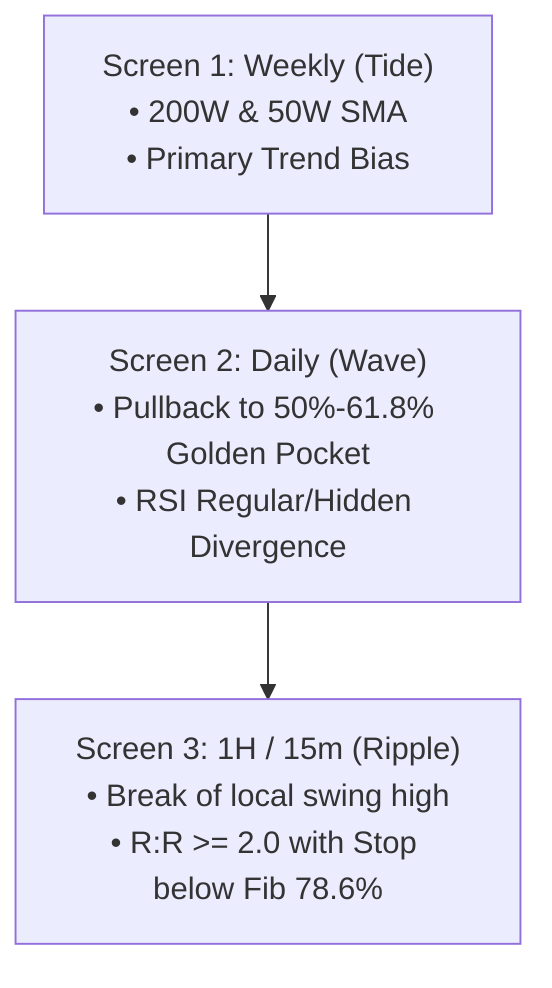

# trader-analyst (Indian Equities)

Provides both programmatic algorithmic calculation and prompt-based theoretical analysis for multi-week swing setups and structural equity research.

```bash
# 1. Multi-Week Swing & Fibonacci Analysis (with RSI Divergence & 3-Screen Score)
python trader-analyst/swing.py RELIANCE.NS
python trader-analyst/swing.py JIOFIN.NS --json

# 2. SEBI LODR Structural Facts & 52-Week Moving Averages
python trader-analyst/facts.py RELIANCE.NS
```

---

## 1. Classical Fibonacci Retracement & Extension Playbook

Fibonacci levels identify high-probability equilibrium zones where price reacts on pullbacks or expansions.

### Retracement Levels (Pullback Entry Zones)
* **23.6%**: Shallow retracement in strong runaway momentum trends.
* **38.2%**: Standard minimum pullback for a healthy trend.
* **50.0% (Equilibrium)**: Dow Theory halfway discount level.
* **61.8% (Golden Ratio)**: Primary institutional accumulation zone. **The 50%–61.8% range is the "Golden Pocket".**
* **78.6%**: Deep retracement; invalidation warning zone. If broken, the prior trend is invalid.

### Extension Levels (Take-Profit Targets)
* **127.2% Ext**: Target 1 for conservative swing scale-out.
* **161.8% Golden Extension**: Target 2 primary swing expansion target.
* **261.8% Ext**: Parabolic runner target.

---

## 2. RSI Momentum Divergence Cheat Sheet

RSI Divergence reveals when price movement is losing underlying volume/momentum fuel:

| Divergence Type | Price Action | RSI (14) Action | Market Meaning | Setup Bias |
| :--- | :--- | :--- | :--- | :--- |
| **Regular Bullish** | **Lower Low** | **Higher Low** | Selling pressure is exhausting; buyers stepping in. | **Reversal Long 🚀** |
| **Regular Bearish** | **Higher High** | **Lower High** | Buying momentum is exhausting at resistance. | **Reversal Short ⚠️** |
| **Hidden Bullish** | **Higher Low** | **Lower Low** | Price pulled back gently while momentum reset deeply. | **Trend Continuation Long 🚀** |
| **Hidden Bearish** | **Lower High** | **Higher High** | Price failed to rebound while momentum overextended. | **Trend Continuation Short ⚠️** |

### Confirmation Rules:
1. Never enter on divergence alone. Require a price trigger (e.g. candlestick reversal, 20-SMA reclaim, or Fib bounce).
2. RSI value must reach below 35 for bullish divergence or above 65 for bearish divergence to qualify as valid exhaustion.

---

## 3. Elder's 3-Screen Multi-Timeframe Confluence System

Never trade against the higher timeframe trend. Use the 3-screen funnel:



### Institutional Confluence Scoring (0 to 10 Points):
* **8 – 10 Points**: **STRONG BUY** (Aligned with weekly trend, Golden Pocket hit, RSI divergence confirmed, R:R $\ge$ 2.0).
* **5 – 7 Points**: **MODERATE WATCH** (Valid macro structure, waiting for lower-timeframe entry trigger).
* **0 – 4 Points**: **NEUTRAL / AVOID** (Counter-trend, low confluence, or unfavorable risk-reward).
