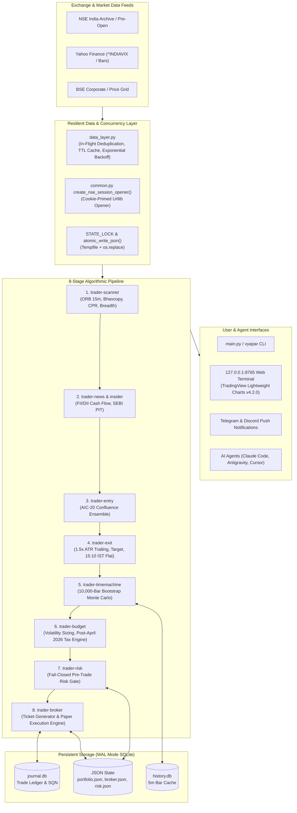
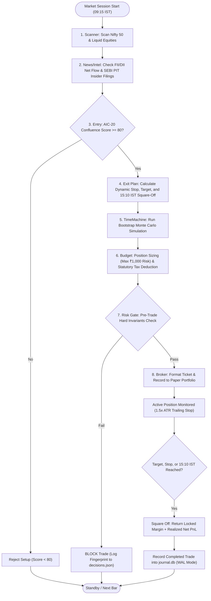
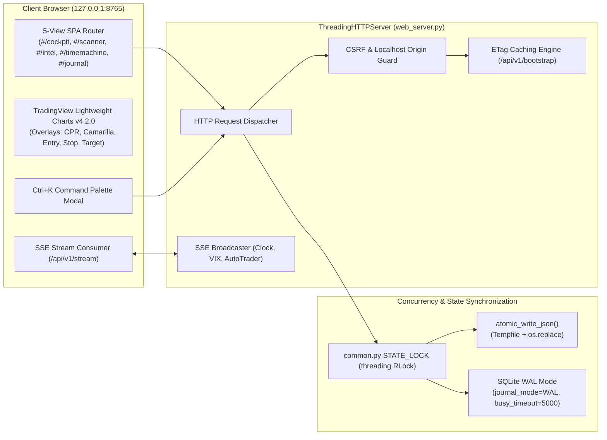
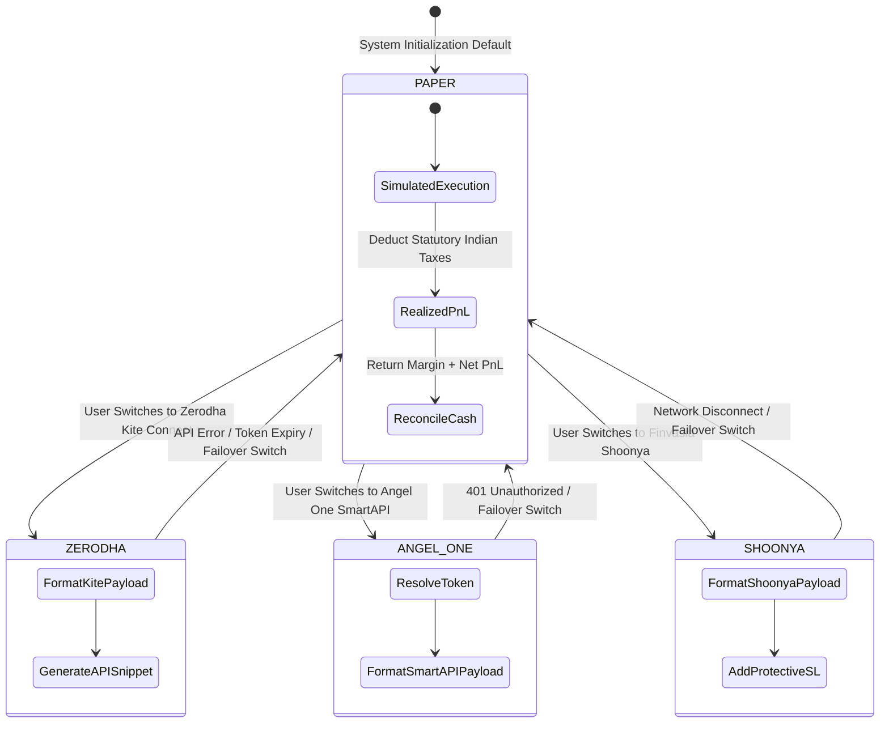

# Vyapar AI — Institutional Architecture & System Design Manual

**Version**: 2.0.0  
**Market Calibration**: National Stock Exchange of India (NSE) & Bombay Stock Exchange (BSE)  
**Engineering Invariant**: Python 3 Standard Library only (Zero mandatory pip dependencies)  
**Operating Mode**: Permanent Paper Trading Simulator default  

---

## 1. System Context & Indian Market Microstructure

Vyapar AI is an algorithmic trading, risk gating, and quantitative execution pipeline engineered for the microstructure of the Indian equity market.

---

## 2. 8-Stage Algorithmic Execution Pipeline

The 8-stage pipeline executes sequentially. If any stage encounters missing data, unreadable configuration, or risk boundary violations, the ticket fails **CLOSED** and execution is blocked.

---

## 3. Web Terminal & Concurrency Architecture

The web dashboard runs on Python's built-in `ThreadingHTTPServer` bound strictly to `127.0.0.1`. All state file writes are atomic and synchronized across threads under `STATE_LOCK`.

---

## 4. Multi-Broker Failover State Machine

Vyapar AI maintains permanent Paper Trading as the fail-safe default. Live broker switching requires deliberate multi-stage cryptographic and interactive confirmation.

---

## 5. Microstructure Calibrations & Compliance Invariants

1. **Exchange Clock & Expiries**:
   - `09:00 - 09:08 IST`: Pre-Open Auction session order collection.
   - `09:15 IST`: NSE opening bell.
   - `09:30 IST`: Earliest allowed intraday entry.
   - `13:45 IST`: Thursday weekly F&O expiry entry cutoff.
   - `14:45 IST`: Daily intraday entry freeze.
   - `15:10 IST`: Compulsory MIS square-off.
   - `15:30 IST`: NSE closing bell.
2. **Indian Statutory Taxation (Finance Act 2026-27)**:
   - **Equity Intraday**: STT 0.025% on sell turnover; Brokerage min(₹20, 0.03%); Stamp Duty 0.003% on buy; Exchange turnover fee 0.00297%; SEBI fee 0.0001%; GST 18% on (Brokerage + Exchange + SEBI).
   - **F&O Futures**: STT 0.05% on sell turnover (Finance Act 2026-27).
   - **F&O Options**: STT 0.15% on sell premium (Finance Act 2026-27).
   - **Statutory Rounding**: All Securities Transaction Tax rounded to the nearest whole rupee (`ROUND_HALF_UP`).
